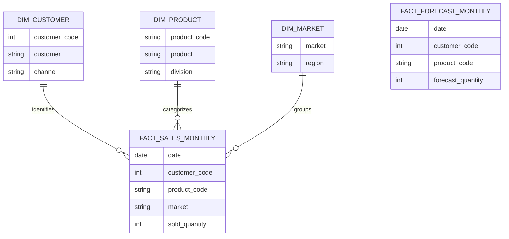
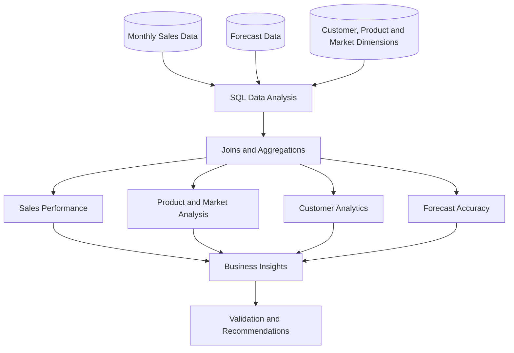

# AtliQ Hardware | Advanced SQL Business Analytics

<p align="center">
  <strong>Sales Performance • Forecast Accuracy • Market Intelligence • Customer Analytics</strong>
</p>

<p align="center">
  
  
  
</p>

A business-focused SQL portfolio project analyzing sales performance, forecast accuracy, product trends, customer behavior, and regional markets using MySQL.

---

## 📌 Table of Contents

- [Project Overview](#-project-overview)
- [Business Problem](#-business-problem)
- [Project Objectives](#-project-objectives)
- [Database Schema](#-database-schema)
- [Project Workflow](#-project-workflow)
- [Tools and Technologies](#-tools-and-technologies)
- [Business Analysis](#-business-analysis)
- [SQL Concepts Demonstrated](#-sql-concepts-demonstrated)
- [Key Business Questions](#-key-business-questions)
- [Repository Structure](#-repository-structure)
- [How to Run](#-how-to-run)
- [Data and Methodology Notes](#-data-and-methodology-notes)
- [Future Improvements](#-future-improvements)
- [Skills Demonstrated](#-skills-demonstrated)

---

## 🎯 Project Overview

This project uses MySQL to explore sales and forecast data from the AtliQ Hardware database schema.

The objective is to transform relational data into meaningful business analysis using SQL queries, aggregations, joins, common table expressions (CTEs), and window functions.

The project covers both foundational SQL and advanced analytical techniques commonly used in business intelligence and data analytics.

**Project highlights:**

- Sales performance analysis across markets, products, and customer channels
- Actual sales versus forecast comparisons
- Month-over-month (MoM) and year-over-year (YoY) growth
- Regional market share and customer rankings
- Forecast bias and WMAPE calculations
- Product classification using cumulative sales volume
- Customer activity and data-quality checks

## 💼 Business Problem

Businesses need to understand what drives sales, where performance is strongest, and whether forecasts accurately reflect actual demand.

This project explores questions such as:

- Which products generate the highest sales volume?
- Which markets contribute the most to regional sales?
- How does actual sales volume compare with forecast quantities?
- Are sales increasing or decreasing over time?
- Which products have no recorded sales?
- How concentrated are sales among customers and products?
- Which divisions show signs of under-forecasting or over-forecasting?

The SQL queries provide a foundation for investigating these questions. Business conclusions should be added after running and validating the queries against the database.

## 🎯 Project Objectives

1. Analyze overall sales volume and forecast quantities.
2. Identify top-performing products, divisions, and markets.
3. Calculate monthly and yearly sales growth.
4. Rank products and customers within business segments.
5. Evaluate forecast errors and forecast bias.
6. Identify unmatched records and potential data-quality issues.
7. Analyze customer activity across consecutive months.
8. Demonstrate advanced SQL techniques through practical business questions.

---

## 🗄️ Database Schema

The project queries use the `gdb041` database and the following tables.

| Table | Description | Key fields used |
|---|---|---|
| `fact_sales_monthly` | Monthly sales fact data | `date`, `sold_quantity`, `customer_code`, `product_code`, `market` |
| `fact_forecast_monthly` | Monthly forecast fact data | `date`, `forecast_quantity`, `customer_code`, `product_code` |
| `dim_customer` | Customer information | `customer_code`, `customer`, `channel` |
| `dim_product` | Product information | `product_code`, `product`, `division` |
| `dim_market` | Market and regional information | `market`, `region` |

### Entity Relationship Diagram



**Forecast matching logic:** The supplied queries join sales and forecast records using `customer_code`, `product_code`, and `date`.

*Note: This is a conceptual schema based on the columns referenced in the SQL files, not a verified physical database diagram. The actual table definitions and key constraints should be checked before production use.*

---

## 🔄 Project Workflow



The workflow represents the analytical process rather than a production ETL pipeline.

## 🛠️ Tools and Technologies

| Technology | Purpose |
|---|---|
| MySQL | Query execution and relational data analysis |
| SQL | Business metrics and data exploration |
| CTEs | Structuring multi-step analytical queries |
| Window functions | Ranking, running totals, and growth analysis |
| GitHub | Version control and project documentation |
| Mermaid | Database and workflow diagrams rendered in Markdown |

---

## 📊 Business Analysis

### 1. Sales Performance Analysis

- Total sales quantity versus total forecast quantity
- Sales breakdown by market
- Top 10 products by sales volume
- Sales by customer channel
- Monthly sales trends for a selected year
- Quarterly sales comparison by division
- Running total of sales by market

### 2. Product and Division Analysis

- Distinct product count per division
- Top-selling product within each division
- Top five products in each region
- Products with no recorded sales
- ABC-style product classification using cumulative sales quantity

### 3. Market and Regional Analysis

- Market share within each region
- Customer sales ranking within each market
- Comparison of market sales with regional average sales
- Market penetration index based on regional averages

### 4. Customer Analytics

- Customer contribution to total sales
- Average sales per customer by channel
- Customers associated with sales records that have no matching forecast
- Customer activity across consecutive months
- Frequently co-occurring product pairs in customer sales records

### 5. Forecast Analysis

- Actual versus forecast quantities by product
- Absolute forecast error
- Products with actual sales greater than 1.5 times forecast
- Forecast bias by division
- Weighted Mean Absolute Percentage Error (WMAPE)

### 6. Time-Series Analysis

- Month-over-month sales growth
- Year-over-year sales growth
- Cumulative sales by market
- Quarterly sales pivot for 2021

### 7. Data Quality Checks

- Sales records without matching customer dimension records
- Products without matching sales records
- Sales combinations without matching forecast records

These checks highlight potential issues for investigation; unmatched records are not automatically proof of incorrect data.

---

## 🧠 SQL Concepts Demonstrated

| SQL concept | Application |
|---|---|
| `SUM()` and `AVG()` | Sales totals and average customer sales |
| `COUNT(DISTINCT ...)` | Counting distinct products |
| `INNER JOIN` | Combining related fact and dimension records |
| `LEFT JOIN` | Finding missing dimension or forecast matches |
| `GROUP BY` and `HAVING` | Segment-level aggregation and filtering |
| `CASE WHEN` | Quarterly sales pivot and ABC classification |
| CTEs (`WITH`) | Organizing multi-step analysis |
| `RANK()` | Identifying top products, including ties |
| `DENSE_RANK()` | Ranking customers within markets |
| `ROW_NUMBER()` | Selecting the top five products per region |
| `LAG()` | Previous-period sales comparisons |
| `SUM() OVER()` | Running totals and cumulative contributions |
| Date functions | Monthly, quarterly, and yearly analysis |
| Self-joins | Customer activity and product-pair analysis |

---

## 🔍 Key Business Questions

| Business question | SQL approach |
|---|---|
| How do total sales compare with total forecast quantities? | Aggregation and scalar subquery |
| Which markets have the highest sales volume? | Joins and grouped aggregation |
| What are the top 10 products by sales? | Aggregation, sorting, and `LIMIT` |
| How are sales distributed across customer channels? | Dimension joins and aggregation |
| What is the month-over-month growth rate? | CTE and `LAG()` |
| Which product leads each division? | CTE and `RANK()` |
| What share of regional sales comes from each market? | Windowed regional totals |
| Which customers rank highest in each market? | `DENSE_RANK()` |
| What are the top five products per region? | `ROW_NUMBER()` |
| Which products have no recorded sales? | `LEFT JOIN` and null filtering |
| How does actual quantity differ from forecast quantity? | Multi-key joins and absolute error |
| Which divisions show forecast bias? | Signed forecast error |
| How does forecast error compare with sales volume? | WMAPE-style calculation |
| Which customers appear in consecutive months? | Self-join and date functions |
| Which product pairs occur most frequently in customer records? | Self-join and aggregation |

---

## 📁 Repository Structure

```text
atliq-hardware-sql-analysis/
│
├── README.md
├── ATLIQ HARDWARE PART 1.sql
└── ATLIQ HARDWARE PART 2.sql
```

The repository contains two SQL files with the original query collections. Their filenames can be retained as shown above.

## 🚀 How to Run

### Prerequisites

- MySQL Server 8.0 or later
- MySQL Workbench or another compatible SQL client
- Access to the `gdb041` database
- The required fact and dimension tables populated with data

### Execution Steps

1. Clone or download this repository.
2. Open MySQL Workbench and connect to your database.
3. Verify that `gdb041` and the required tables exist.
4. Open either SQL file.
5. Execute the queries individually or in manageable sections.
6. Validate the result sets before drawing business conclusions.

The SQL files begin with:

```sql
USE gdb041;
```

If your database has a different name, update the statement to match your environment.

**Important:** The repository contains analytical queries, not database creation scripts or source data files.

---

## 📚 Query Index

### Part 1 — Sales and Business Analysis

| # | Query | Main SQL technique |
|---:|---|---|
| 1 | Total Sales vs. Total Forecast | Aggregation, scalar subquery |
| 2 | Sales Breakdown by Market | Join, `GROUP BY` |
| 3 | Top 10 Products by Sales Volume | Aggregation, `ORDER BY`, `LIMIT` |
| 4 | Sales by Customer Channel | Join, aggregation |
| 5 | Monthly Sales Trend | Date functions |
| 6 | Orphaned Customer Fact Records | `LEFT JOIN` |
| 7 | Distinct Product Count per Division | `COUNT(DISTINCT ...)` |
| 8 | Actual vs. Forecast by Product | Multi-key join, absolute error |
| 9 | Top-Selling Product per Division | CTE, `RANK()` |
| 10 | Customers with Sales but No Forecast | `LEFT JOIN`, null filtering |
| 11 | Monthly Sales Growth | CTE, `LAG()` |
| 12 | Market Share by Region | Window functions |
| 13 | Customer Sales Ranking by Market | `DENSE_RANK()` |
| 14 | Products with High Sales but Low Forecast | `HAVING` |
| 15 | Quarterly Sales Pivot | Conditional aggregation |

### Part 2 — Advanced Analytical SQL

| # | Query | Main SQL technique |
|---:|---|---|
| 1 | Running Total of Sales by Market | Windowed cumulative sum |
| 2 | Customer Contribution to Total Sales | CTE, window functions |
| 3 | Average Sales per Customer by Channel | Derived table, aggregation |
| 4 | Identify Products Never Sold | `LEFT JOIN` |
| 5 | Year-over-Year Sales Comparison | CTE, self-join |
| 6 | Top 5 Products per Region | `ROW_NUMBER()` |
| 7 | Forecast Bias by Division | Signed error aggregation |
| 8 | Markets Above/Below Regional Average | CTEs, regional benchmark |
| 9 | Customer Consecutive-Month Activity | Self-join, date functions |
| 10 | ABC-Style Product Classification | Cumulative sum, `CASE` |
| 11 | Forecast Accuracy Weighted by Volume | WMAPE-style calculation |
| 12 | Frequently Co-occurring Product Pairs | Self-join, aggregation |

---

## ⚠️ Data and Methodology Notes

A few analytical details matter when interpreting these queries:

1. **Sales quantity is not revenue.** The ABC-style classification uses `sold_quantity` as a proxy. It does not calculate monetary revenue.
2. **Validate the fact-table grain.** Joining sales and forecast data on customer, product, and date assumes the records align at that level. Duplicate keys can multiply rows and inflate aggregates.
3. **Overall totals and matched totals differ.** The total-sales-versus-total-forecast query aggregates sales and forecast independently, whereas the product-level comparisons use matching records.
4. **Missing forecasts are not necessarily zero forecasts.** An unmatched forecast row differs from a matched row whose `forecast_quantity` equals zero.
5. **WMAPE needs clear interpretation.** The supplied formula divides total absolute error by total sold quantity. Multiply by 100 to express it as a percentage, and handle zero denominators explicitly.
6. **Growth rates need zero-denominator handling.** MoM and YoY growth cannot be calculated normally when the previous period's sales are zero.
7. **Window-function ties matter.** Cumulative calculations can behave differently when multiple rows share the same ordering value. Validate the intended window frame and ordering.
8. **Channel averages depend on the chosen grain.** Average customer sales by channel is not the same as average monthly sales per customer.
9. **Product-pair frequency is not necessarily basket-level co-purchase.** The self-join counts matching sales records for customers. Without transaction identifiers and time-window rules, it does not prove two products were purchased in the same order.
10. **Consecutive-month activity is a limited retention proxy.** The supplied query returns customer records for adjacent months and limits the result to 100 rows. It does not calculate a complete cohort-retention rate.
11. **Time filters vary by query.** The quarterly pivot is restricted to 2021, while the MoM query uses all available dates.
12. **Validate all findings.** Numerical results and business conclusions should be added only after executing the queries against the actual database.

---

## 🚀 Future Improvements

Potential next steps to make the project more robust:

- Validate uniqueness and null rates for join keys.
- Confirm the grain of both fact tables.
- Add safe handling for zero denominators.
- Standardize growth and accuracy metrics as percentages.
- Add configurable date filters.
- Use `EXPLAIN` to review query execution plans.
- Evaluate indexes based on query patterns and data distribution.
- Organize SQL files into topic-based folders.
- Add verified output screenshots and a results section.
- Document data provenance and schema definitions where available.

These are proposed improvements, not features claimed to be already implemented.

## 💡 Skills Demonstrated

- Relational data analysis using MySQL
- Business-oriented metric design
- Multi-table joins and data-quality checks
- Aggregation and conditional aggregation
- CTE-based query organization
- Ranking and analytical window functions
- Time-series and cumulative calculations
- Forecast error and bias analysis
- Translation of business questions into SQL
- Documentation of assumptions and analytical limitations

---
## 👨‍💻 About
This project demonstrates SQL-based business analysis using the AtliQ Hardware database schema. It provides a foundation for exploring sales performance, forecast quality, customer activity, and market trends through practical analytical queries.

