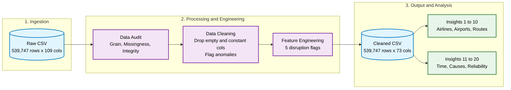

<div align="center">

# ✈️ Aviation Operational Performance — Analysis

**End-to-end exploratory analysis of U.S. flight operations, January 2025**


[Overview](#-overview) · [Key Findings](#-key-findings) · [Pipeline](#-analysis-pipeline) · [Insights](#-insight-catalogue) · [Run It](#-getting-started) · [Limitations](#-limitations--next-steps)

</div>

---

## 📌 Overview

This folder contains the **Python analysis layer** of the Aviation Operational Performance project. It takes a raw 109-column flight-operations extract, audits and cleans it, validates it against business rules, and answers **20 operational questions** about delays, cancellations, airlines, airports, routes, and time-of-day patterns.

**The core question:** *Where, when, and why do flights get disrupted, and what should an operations team do about it?*

| | |
|---|---|
| **Scope** | U.S. domestic flights, January 2025 |
| **Grain** | One scheduled flight operation (date + airline flight number + origin + destination + scheduled departure) |
| **Raw input** | 539,747 records × 109 columns |
| **Analysis output** | 73 columns, including 5 engineered disruption flags |
| **Stack** | Python · Pandas · NumPy · Matplotlib · Seaborn |

---

## 🔑 Key Findings

| # | Finding | Evidence |
|---|---------|----------|
| 1 | **Roughly 1 in 5 flights arrives 15+ minutes late** | 18.23% network delay rate; 6.18% of flights are delayed 60+ minutes |
| 2 | **Delays are airline-dependent** | Frontier (F9) is worst at 25.28%; Southwest (WN) is best at 14.75% |
| 3 | **Carrier and late-aircraft problems drive most delay minutes** | Carrier 36.92% + Late Aircraft 34.75% + NAS 19.40% = **91.07%** of all delay minutes; weather is only 8.78% |
| 4 | **Delay risk builds through the day** | Peak departure block 20:00–20:59 at 22.62%; best arrival block 07:00–07:59 at 12.48% |
| 5 | **The week is uneven** | Thursday is busiest (83,082 flights), Saturday quietest (57,139); Monday has the worst delay rate (22.32%) and Wednesday the best (12.93%) |
| 6 | **Traffic is concentrated** | The top 10 departure airports handle 34.33% of all flights; Denver leads on volume *and* has a 24.54% delay rate |
| 7 | **Problem routes are identifiable** | Among routes with 100+ flights, HSV → DCA is worst at 44.55%; BOS → PBI and BOS → RSW are the worst high-volume routes (41.60%, 40.69%) |
| 8 | **Carrier OH has an outlier cancellation rate** | 9.00% versus a network average of 2.98% |

> 💡 **Takeaway for operations teams:** Because carrier-controllable causes and knock-on late aircraft account for about 72% of delay minutes, the largest improvement lever is turnaround and rotation planning, not weather mitigation.

---

## 🧭 Analysis Pipeline


### Stage 1 — Data Cleaning (`DATA_CLEANING_AVIATION.ipynb`)

| Step | What was done | Result |
|------|---------------|--------|
| **Grain definition** | Tested "1 row = 1 flight" against flight date, airline, flight number, origin, destination | Found 398 duplicate-key rows, so the key was extended with scheduled departure time |
| **Empty columns** | Removed columns that were 100% null | 109 → 85 columns |
| **Diversion columns** | Removed sparse `Div1*` / `Div2*` fields (>95% missing) | 85 → 71 columns |
| **Structural missingness** | Profiled nulls instead of imputing blindly | `CancellationCode` is null for **all** 523,435 non-cancelled flights and populated for **all** 16,312 cancelled ones, so the nulls are meaningful, not errors |
| **Constant columns** | Dropped single-value fields (e.g. `Flights`) | 71 → 68 columns |
| **Integrity checks** | Negative distance/duration, impossible delays, `HHMM` validity (incl. `2400`), duration arithmetic | `TaxiOut + AirTime + TaxiIn = ActualElapsedTime` held for all 522,269 flights with complete data |
| **Chronology checks** | `DepTime ≤ WheelsOff ≤ WheelsOn ≤ ArrTime` | 10 rare inconsistencies **flagged and retained**, not silently altered |
| **Feature engineering** | Added `IsDelayed`, `IsDelayed15`, `IsCancelled`, `IsDiverted`, `IsSeverelyDelayed` | 68 → 73 columns |

**Design principle:** missing values are explained before they are removed. All 17,478 flights lacking arrival data are exactly the cancelled (16,312) plus diverted (1,166) flights.

### Stage 2 — Insight Analysis (`INSIGHT_ANALYSIS_01` & `_02`)

Each insight follows the same pattern: **business question → aggregation → visualization → interpretation**. Rates are used instead of raw counts so that large and small carriers, airports, and routes compare fairly, and route-level rankings require a minimum of 100 flights to avoid small-sample noise.

---

## 📚 Insight Catalogue

### Part 1: `INSIGHT_ANALYSIS_01.ipynb` (Insights 1–10)

| # | Question | Headline |
|---|----------|----------|
| 1 | What is the overall scale and disruption profile? | 487,346 flights · 12 airlines · 318 airports · 5,434 routes · 2.98% cancelled · 0.22% diverted |
| 2 | Which airlines have the highest and lowest delay rates? | F9 25.28% (worst) → WN 14.75% (best) |
| 3 | Which airlines cancel the most? | OH 9.00%, YX 4.02%, AA 3.73% at the top; G4 1.25%, AS 1.34%, B6 1.80% at the bottom |
| 4 | Which airports have the highest cancellation rates? | Airport-level cancellation ranking |
| 5 | Which high-traffic airports also have high delay rates? | DEN 24.54%, ATL 21.99%, DFW 21.56%, ORD 20.55% |
| 6 | Which airports have the most departures? | DEN 24,701 · ATL 23,096 · DFW 19,275 |
| 7 | Which airports receive the most arrivals? | DEN 24,710 · ATL 23,089 · DFW 19,277 |
| 8 | Which routes carry the most flights? | Route-level volume ranking |
| 9 | Which routes have the highest delay rates? | HSV → DCA 44.55%, ORD → ASE 44.06%, DEN → MAF 42.02% |
| 10 | Which routes combine high traffic and high delay? | BOS → PBI, BOS → RSW, BOS → TPA, JFK → PBI |

### Part 2: `INSIGHT_ANALYSIS_02.ipynb` (Insights 11–20)

| # | Question | Headline |
|---|----------|----------|
| 11 | Are delays concentrated on specific routes? | Reliability tiers: Good (<20%) · Moderate · Poor · Critical (>40%) |
| 12 | Which days carry the most traffic? | Thursday 83,082 vs Saturday 57,139 |
| 13 | Which days are most delay-prone? | Monday 22.32% vs Wednesday 12.93% (network 18.23%) |
| 14 | Which departure time blocks are worst? | 20:00–20:59 at 22.62%, followed by 19:00 at 22.36% |
| 15 | Which arrival time blocks are worst? | 18:00–18:59 at 22.44% vs 07:00–07:59 at 12.48% |
| 16 | What causes delay minutes? | Carrier 36.92% · Late Aircraft 34.75% · NAS 19.40% · Weather 8.78% · Security 0.14% |
| 17 | How often does each cause occur, versus how much it costs? | Most frequent: Carrier (34.46%), NAS (32.63%), Late Aircraft (27.92%) |
| 18 | Why is each airline delayed? | DL and OO are carrier-driven (41.78%, 48.54%); AA, WN, UA, OH, F9, B6 are late-aircraft-driven |
| 19 | Which airports combine heavy traffic with poor reliability? | Airports segmented into four traffic × delay quadrants (DEN, DTW, PHL, MIA, ATL, DFW in the high-delay group) |
| 20 | What are the best and worst routes? | Worst HSV → DCA (44.55%); best ITO → HNL (1.94%) and BOI → LAX (2.31%) |

---

## 📁 Folder Structure

```text
ANALYSIS/
├── DATA_CLEANING_AVIATION.ipynb   # Audit, validation, cleaning, feature engineering
├── INSIGHT_ANALYSIS_01.ipynb      # Insights 1–10: airlines, airports, routes
├── INSIGHT_ANALYSIS_02.ipynb      # Insights 11–20: time patterns, delay causes, reliability
└── README.md
```

**Run order:** `DATA_CLEANING_AVIATION` → `INSIGHT_ANALYSIS_01` → `INSIGHT_ANALYSIS_02`. The cleaning notebook writes `aviation_cleaned_JAN2025.csv`, which both insight notebooks read.

---

## 🚀 Getting Started

**Prerequisites:** Python 3.10+

```bash
# 1. Clone the repository
git clone https://github.com/<your-username>/<your-repo>.git
cd <your-repo>/ANALYSIS

# 2. Create an environment and install dependencies
python -m venv .venv
source .venv/bin/activate          # Windows: .venv\Scripts\activate
pip install pandas numpy matplotlib seaborn jupyter

# 3. Place the raw data (see ../DATA) as data1_raw.csv, then launch
jupyter notebook
```

Run the notebooks in the order listed above.

---

## ⚠️ Limitations & Next Steps

**Limitations**
- **Single month.** January has winter-weather and holiday effects, so results should not be generalised to the full year.
- **Delay-cause columns are only populated for delayed flights**, so cause shares describe delayed flights rather than all flights.
- **Descriptive, not causal.** The analysis identifies patterns and concentrations; it does not prove why they occur.
- **Small-sample routes excluded.** Route rankings use a 100-flight minimum (1,608 routes qualify).

**Next steps**
- Extend to 12 months to separate seasonality from structural issues
- Add a statistical test for the day-of-week and time-block differences
- Build a delay-prediction baseline model
- Link results to the interactive dashboard in [`../Dashboard`](../Dashboard) and the SQL work in [`../Query`](../Query)

---

## 🔗 Related Project Folders

| Folder | Purpose |
|--------|---------|
| [`DATA`](../DATA) | Raw data and data dictionary |
| **`ANALYSIS`** | You are here: Python cleaning and EDA |
| [`Query`](../Query) | SQL queries |
| [`Dashboard`](../Dashboard) | Interactive dashboard |

---

<div align="center">

**Author:** _Your Name_ · [LinkedIn](https://linkedin.com/in/your-handle) · [GitHub](https://github.com/your-username)

</div>

<!-- TODO before publishing: confirm the data source/citation, and reconcile the row count (cleaning notebook: 539,747 flights; insight notebooks: 487,346 flights). -->
