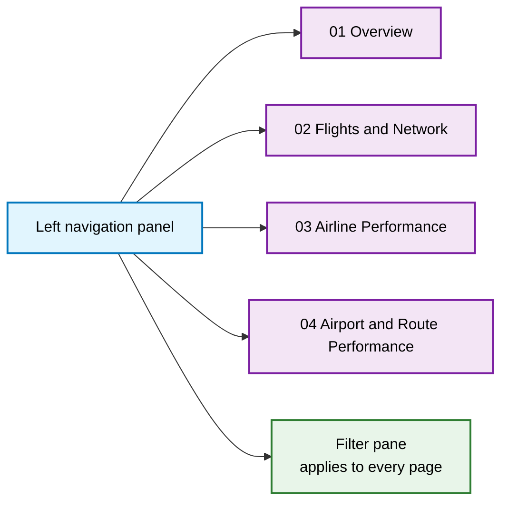

<div align="center">

# 📊 Aviation Operations Dashboard

**Interactive Power BI dashboard for flight volume, punctuality, and network performance**


[Overview](#-overview) · [Preview](#-dashboard-preview) · [Pages](#-page-guide) · [Filters](#-filter-pane) · [Cross-Check](#-cross-validation-with-python-and-sql) · [Limitations](#-limitations--next-steps)

</div>

---

## 📌 Overview

This dashboard is the **presentation layer** of the Aviation Operational Performance project. The [`ANALYSIS`](../ANALYSIS) folder finds the patterns in Python and the [`Query`](../Query) folder re-checks them in SQL. This dashboard lets a non-technical user explore the same story interactively.

It answers four questions, one per page:

| Page | Question |
|------|----------|
| **01 Overview** | How big is the network and how is it performing overall? |
| **02 Flights & Network** | Which airports and routes carry the traffic, and how do distance and delay relate? |
| **03 Airline Performance** | Which airlines are punctual, and where do delay minutes come from? |
| **04 Airport & Route Performance** | Which airports and states have the worst delay and cancellation profile, and why? |

| | |
|---|---|
| **Tool** | Microsoft Power BI |
| **Period** | 1 January 2025 – 31 March 2025 |
| **Volume** | 1.65M flights |
| **Navigation** | Left-hand button panel plus a global filter pane |

---

## 🖼️ Dashboard Preview

<div align="center">


*Page 01: Overview*

</div>

---

## 🧭 Page Guide



Every page shares the same **KPI strip** at the top:

| KPI | Meaning |
|-----|---------|
| **Total Flights** | 1.65M flights in the selected period, with month-over-month change |
| **On-Time %** | 81.32% of flights on time, with change versus the prior period |
| **Dept Delay** | Average departure delay (14.81 minutes) |
| **Arr Delay** | Average arrival delay |
| **Divert** | Diversion rate (0.23%) |

### 01 · Overview


| Visual | What it shows |
|--------|---------------|
| **Total Origin Airports (Flight Volume)** | Top 5 origin airports: DFW (75K), DEN (74K), ATL (73K), ORD (66K), PHX (51K) |
| **Daily Flight Trend** | Daily flights across the period with a month selector; shows a weekly rhythm between roughly 15K and 20K flights per day in January |
| **Airport Delay Heatmap** | Average arrival, carrier, and departure delay per origin airport, with in-cell colour bars |
| **Key Insight card** | DFW has the highest volume with 4.6% of flights (75,088) and a 77.1% on-time departure rate |

### 02 · Flights & Network


| Visual | What it shows |
|--------|---------------|
| **Route Distance vs Delay** | Bubble chart: each route by distance (x), average arrival delay (y) and flight volume (bubble size) |
| **Top 5 Airports (Flight Volume)** | Airport, total flights and share of network traffic |
| **Flight Characteristics (Volume vs Bucket)** | Flight volume by distance bucket (under 500 miles up to over 2,000) with a line overlay |

### 03 · Airline Performance


| Visual | What it shows |
|--------|---------------|
| **Airport Delay Treemap** | For the busiest airports (ATL, DFW, DEN), the average carrier, NAS, departure, arrival, and weather delay components |
| **On-Time Departure % vs Flight Volume by Airline** | Bubble chart separating large carriers (for example Southwest) from smaller ones, with on-time rate on the y-axis |

### 04 · Airport & Route Performance


| Visual | What it shows |
|--------|---------------|
| **Airport Performance Matrix** | Origin, flight volume, on-time %, average delay (minutes), and cancel rate, with status icons and data bars |
| **Delay Bucket by Origin State** | Choropleth map shading states from under 10 to over 26 average delay minutes |
| **Delay Cause Profile (All Airlines)** | Donut chart: Late Aircraft 37.07%, Carrier 34.25%, NAS 21.47%, Weather 7.07%, with Security and Other making up the small remainder |

---

## 🎛️ Filter Pane

A slide-in pane opened from the **Filter** button applies to every page.


| Group | Fields |
|-------|--------|
| **Flight & Network** | Reporting Airline · Origin · Destination |
| **Time & Performance** | Month · Day of Week · Distance |
| **Status & Checkbox** | Cancelled · Is Diverted · Is Delayed (15+ min) |

The **Clear** button resets every selection and **Close** hides the pane.

---

## 🔁 Cross-Validation with Python and SQL

The dashboard covers three months and the Python notebooks cover January, so exact figures differ. The *shape* of the findings matches:

| Finding | Python (Jan) | Dashboard (Jan–Mar) |
|---------|--------------|---------------------|
| Largest delay-minute causes | Carrier 36.92%, Late Aircraft 34.75%, NAS 19.40% | Late Aircraft 37.07%, Carrier 34.25%, NAS 21.47% |
| Weather share of delay | 8.78% | 7.07% |
| Top three causes combined | 91.07% | 92.79% |

In both, carrier-side problems and knock-on late aircraft account for roughly 70% of delay minutes, while weather is a minor driver.

---

## 📁 Folder Structure

```text
Dashboard/
├── screenshots/
│   ├── 01_overview.png
│   ├── 02_flights_network.png
│   ├── 03_airline_performance.png
│   ├── 04_airport_route_performance.png
│   └── filter_pane.png
├── <dashboard-file>.pbix        # add your Power BI file here
└── README.md
```

## 🚀 Getting Started

1. Install **Power BI Desktop** (free, Windows).
2. Open the `.pbix` file in this folder.
3. If prompted, point the data source at the cleaned flight data (see [`DATA`](../DATA)) and click **Refresh**.
4. Use the left navigation to switch pages and the **Filter** button to slice the data.

---

## ⚠️ Limitations & Next Steps

**Limitations**
- Static screenshots only; interactivity (cross-filtering, tooltips) is visible only in Power BI.
- Averages rank very small airports alongside large hubs unless a minimum-flight filter is applied.
- Three months cannot show full-year seasonality.

**Next steps**
- Publish to Power BI Service and add the public link here
- Add a minimum-flight threshold to the airport matrix, matching the SQL queries (1,000 for airports, 100 for routes)
- Add a data dictionary for each measure (on-time %, average delay, MoM change)

---

## 🔗 Related Project Folders

| Folder | Purpose |
|--------|---------|
| [`DATA`](../DATA) | Raw data and data dictionary |
| [`ANALYSIS`](../ANALYSIS) | Python cleaning and EDA |
| [`Query`](../Query) | SQL validation |
| **`Dashboard`** | You are here: interactive dashboard |

---

<div align="center">

**Author:** _Your Name_ · [LinkedIn](https://linkedin.com/in/your-handle) · [GitHub](https://github.com/your-username)

</div>

<!-- TODO before publishing: add the .pbix file and live link, document the "Insight" page (not in the screenshots provided), and define the On-Time % measure. -->
