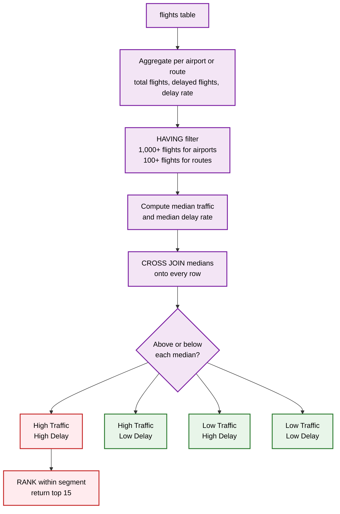

<div align="center">

# 🗄️ Aviation Operational Performance — SQL Validation

**Re-running the core Python insights in SQL against a three-month dataset**


[Purpose](#-purpose) · [Query Catalogue](#-query-catalogue) · [SQL Techniques](#-sql-techniques-demonstrated) · [Metric Definitions](#-metric-definitions) · [Run It](#-getting-started)

</div>

---

## 📌 Purpose

The [`ANALYSIS`](../ANALYSIS) folder answers 20 operational questions for **January 2025** using Python. This folder asks a different question:

> **Do those patterns still hold when the same questions are asked in SQL, on a larger three-month dataset?**

Each query mirrors an insight from the Python notebooks (Insights 1–10 in Part 1), so results can be compared side by side. Agreement across tools and time windows is evidence that the findings reflect real operational patterns rather than quirks of one month or one tool.

| | |
|---|---|
| **Database** | MySQL 8.0+ |
| **Schema / table** | `flight_aviation.flights` |
| **Data window** | Three months of U.S. flight records |
| **Scope of this file** | Insights 1–10, plus three supporting summary queries (5B, 10B) |
| **File** | [`INSIGHTS_VALIDATION_3_MONTHS_PART1.sql`](./INSIGHTS_VALIDATION_3_MONTHS_PART1.sql) |

---

## 📚 Query Catalogue

| # | Question | Output | Filters |
|---|----------|--------|---------|
| 1 | What is the overall scale and disruption profile? | Metric / value table: flights, airlines, airports, routes, delay, cancellation, diversion, severe-delay rates | none |
| 2 | Which airlines have the highest and lowest delay rates? | Delay rate with worst and best rank per airline | none |
| 3 | Which airlines cancel the most? | Cancellation rate, share of all network cancellations, worst and best rank | none |
| 4 | Which airports have the highest cancellation rates? | Top 15 with gap versus the network average | 1,000+ flights |
| 5 | Which high-traffic airports also have high delay rates? | Top 15 in the *High Traffic / High Delay* quadrant | 1,000+ flights |
| 5B | How are airports distributed across the four quadrants? | Airport count per segment | 1,000+ flights |
| 6 | Which airports have the most departures? | Top 15 with traffic share and cumulative share | none |
| 7 | Which airports are busiest overall? | Top 15 by departures + arrivals, with net flow difference | none |
| 8 | Which routes carry the most flights? | Top 15 routes with traffic share | none |
| 9 | Which routes have the highest delay rates? | Top 15 routes | 100+ flights |
| 10 | Which routes combine high traffic and high delay? | Top 15 in the *High Traffic / High Delay* quadrant | 100+ flights |
| 10B | How are routes distributed across the four quadrants? | Route count per segment | 100+ flights |

---

## 🧠 SQL Techniques Demonstrated

| Technique | Where it is used |
|-----------|------------------|
| **CTEs** (multi-step `WITH` chains) | Every query from Insight 2 onward |
| **Window functions**: `RANK()`, `ROW_NUMBER()`, `COUNT() OVER ()` | Rankings (2–10), median calculation (5, 10) |
| **Running totals** with `SUM() OVER (ORDER BY …)` | Cumulative traffic share (6) |
| **Median without a built-in function** (`ROW_NUMBER` + `COUNT OVER`, averaging the middle one or two rows) | Quadrant thresholds (5, 5B, 10, 10B) |
| **Quadrant segmentation** with `CASE WHEN` on traffic × delay medians | 5, 5B, 10, 10B |
| **Scalar CTE + `CROSS JOIN`** to compare each row with a network-wide value | Network averages (3, 4), medians (5, 10), grand totals (6, 8) |
| **`HAVING` volume thresholds** to remove small-sample noise | 4, 5, 9, 10 |
| **`UNION` / `COALESCE`** to combine airports that only appear as origin or only as destination | Departures vs arrivals (7) |
| **Conditional aggregation** (`SUM(CASE WHEN …)`) | All rate calculations |

---

## 📐 Metric Definitions

| Metric | SQL definition |
|--------|----------------|
| 15+ minute delay | `dep_delay >= 15` |
| Severe delay | `dep_delay >= 60` |
| Cancellation rate | `SUM(cancelled) / COUNT(*) × 100` |
| Diversion rate | `SUM(diverted) / COUNT(*) × 100` |
| Route | `origin → dest` (directional) |
| Quadrant threshold | **Median** traffic and **median** delay rate of the qualifying airports or routes |

> ⚠️ **Read before comparing with the Python results.**
> The SQL queries define a delay from **departure delay** (`dep_delay`), while the Python notebooks define it from **arrival delay** (`ArrDel15` / `ArrDelayMinutes`). The data window also differs (three months here, January 2025 there). Compare **rankings and patterns** (which airlines, airports, and routes sit at the top and bottom), not exact percentages.

---

## 🏗️ Database Setup Workflow

How the `flights` table was prepared before any insight query was run:

```mermaid
flowchart LR
    A["Cleaned flight data<br/>3-month extract"] --> B["CREATE DATABASE<br/>flight_aviation"]
    B --> C["Create flights table<br/>and load the data"]
    C --> D["SHOW TABLES<br/>confirm table exists"]
    D --> E["DESCRIBE flights<br/>verify columns and types"]
    E --> F["Run Insights 1 to 10"]
    F --> G["Compare rankings<br/>with Python results"]

    classDef dataNode fill:#e1f5fe,stroke:#0277bd,stroke-width:2px,color:#000
    classDef sqlNode fill:#f3e5f5,stroke:#7b1fa2,stroke-width:2px,color:#000
    classDef outNode fill:#e8f5e9,stroke:#2e7d32,stroke-width:2px,color:#000

    class A dataNode
    class B,C,D,E,F sqlNode
    class G outNode
```



| Step | Statement | Purpose |
|------|-----------|---------|
| 1 | `CREATE DATABASE flight_aviation;` | Create the project database |
| 2 | Create `flights` and load the data | Populate the table the queries read from |
| 3 | `SHOW TABLES;` | Confirm the table exists |
| 4 | `DESCRIBE flights;` | Verify column names and data types |

## 🔍 How the Quadrant Queries Work

Insights 5 and 10 use the same pattern to turn raw counts into a priority list of airports and routes:



The **High Traffic / High Delay** segment is the priority list: busy airports or routes where delays affect the most passengers. Queries 5B and 10B return how many airports or routes fall into each of the four segments.

---

## 📁 Folder Structure

```text
Query/
├── INSIGHTS_VALIDATION_3_MONTHS_PART1.sql   # Insights 1–10 (+ 5B, 10B)
└── README.md
```

---

## 🚀 Getting Started

**Prerequisites:** MySQL 8.0 or later (the queries use CTEs and window functions, which MySQL 5.7 does not support).

```sql
-- 1. Create and select the database
CREATE DATABASE IF NOT EXISTS flight_aviation;
USE flight_aviation;

-- 2. Load the flight data into a table named `flights`
--    (see the data folder for the source files)

-- 3. Confirm the table exists
DESCRIBE flights;
```

Then run the script, either in MySQL Workbench or from the command line:

```bash
mysql -u <user> -p flight_aviation < INSIGHTS_VALIDATION_3_MONTHS_PART1.sql
```

### Columns the queries rely on

| Column | Meaning |
|--------|---------|
| `reporting_airline` | Airline code |
| `origin` | Origin airport |
| `dest` | Destination airport |
| `dep_delay` | Departure delay in minutes |
| `cancelled` | 1 if cancelled, else 0 |
| `diverted` | 1 if diverted, else 0 |

---

## ⚠️ Limitations & Next Steps

**Limitations**
- **Departure-based delays** differ from the arrival-based definition used in Python.
- **Part 1 only.** Time-of-day, day-of-week, and delay-cause insights (Python Insights 11–20) are not yet covered in SQL.
- **Medians are computed per qualifying subset**, so quadrant cut-offs shift with the volume threshold.

**Next steps**
- Add Part 2 covering Insights 11–20
- Add a `schema.sql` so the table can be rebuilt from scratch
- Add an arrival-delay variant of each query for a like-for-like comparison with Python
- Feed the result sets into the [`Dashboard`](../Dashboard)

---

## 🔗 Related Project Folders

| Folder | Purpose |
|--------|---------|
| [`DATA`](../DATA) | Raw data and data dictionary |
| [`ANALYSIS`](../ANALYSIS) | Python cleaning and EDA |
| **`Query`** | You are here: SQL validation |
| [`Dashboard`](../Dashboard) | Interactive dashboard |

---

<div align="center">

**Author:** _Your Name_ · [LinkedIn](https://linkedin.com/in/your-handle) · [GitHub](https://github.com/your-username)

</div>

<!-- TODO before publishing: state which three months the data covers, and add the table schema or load script. -->
