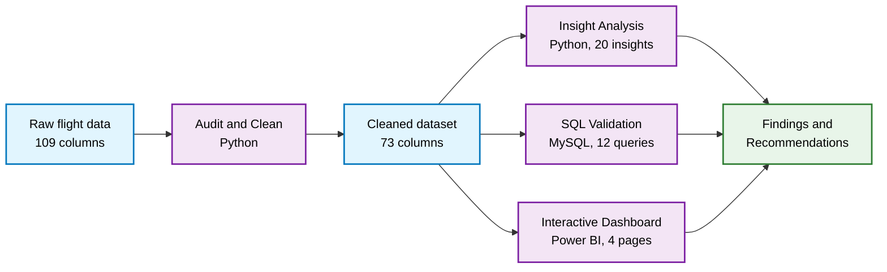
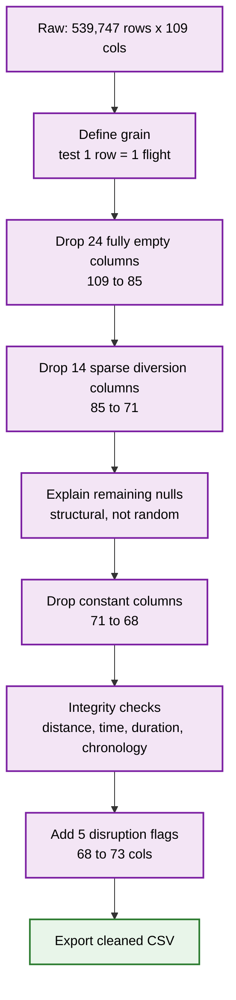
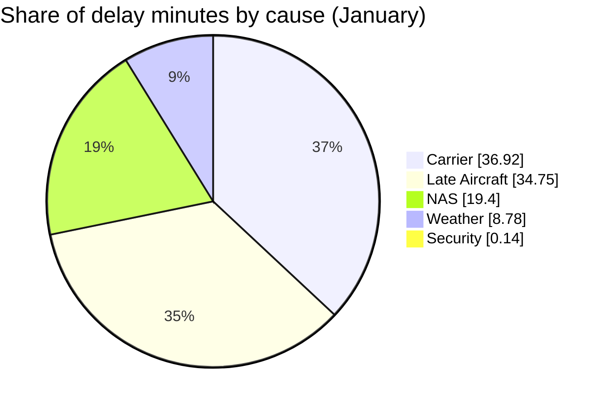

<div align="center">

# ✈️ Aviation Sector: Operational Performance Analytics

**An end-to-end data analytics project: raw flight records → audited and cleaned dataset → Python insights → SQL validation → interactive dashboard**


</div>


---

## 📑 Table of Contents

1. [TL;DR](#-tldr)
2. [Business Problem](#-business-problem)
3. [Project at a Glance](#-project-at-a-glance)
4. [Architecture](#-project-architecture)
5. [Dataset](#-dataset)
6. [Data Cleaning and Validation](#-data-cleaning-and-validation)
7. [Metric Definitions](#-metric-definitions)
8. [Key Findings in Detail](#-key-findings-in-detail)
9. [Insight Catalogue](#-insight-catalogue)
10. [SQL Validation](#-sql-validation)
11. [Dashboard](#-dashboard)
12. [Cross-Tool Consistency](#-cross-tool-consistency)
13. [Recommendations](#-recommendations)
14. [Challenges and Solutions](#-challenges-and-solutions)
15. [Repository Structure](#-repository-structure)
16. [How to Reproduce](#-how-to-reproduce)
17. [Limitations and Roadmap](#-limitations-and-roadmap)
18. [Glossary](#-glossary)
19. [FAQ](#-faq)
20. [Skills Demonstrated](#-skills-demonstrated)
21. [Author](#-author)

---

## ⚡ TL;DR

I analysed **1.65 million U.S. flight records (January–March 2025)** to understand *where, when, and why flights get disrupted.* The same questions were answered in **three tools** (Python, SQL, Power BI) so the conclusions are cross-checked rather than dependent on one method.

| | |
|---|---|
| **Headline result** | Roughly **1 in 5 flights arrives 15+ minutes late**, and about **70% of delay minutes come from carrier-side and knock-on (late aircraft) causes, not weather** |
| **Scale** | 1.65M flights · 3 months · 109 raw fields cleaned to 73 analysis-ready columns |
| **Deliverables** | 3 Jupyter notebooks · 12 SQL queries · 4-page interactive dashboard · 20 documented insights |
| **Approach** | Audit first, explain missing data before removing it, use rates not counts, validate across tools |

---

## 🎯 Business Problem

Delays, cancellations, and diversions cost airlines money and erode passenger trust. Operations teams cannot fix everything at once, so they need to know **where to focus first**.

**Who this analysis is for**

| Audience | What they get |
|----------|---------------|
| **Airline operations managers** | Which routes, time blocks, and delay causes to target |
| **Airport planners** | Which airports combine heavy traffic with poor reliability |
| **Network and schedule planners** | Day-of-week and time-of-day patterns for staffing and buffers |
| **Executives** | A single dashboard with headline KPIs |

**Questions answered**

1. How large is the network, and how reliable is it overall?
2. Which **airlines**, **airports**, and **routes** perform best and worst?
3. Do delays follow a **pattern in time**: by day of week or hour of day?
4. What is **causing** delays: the airline, the air-traffic system, weather, or knock-on effects?
5. Where do **high traffic and poor reliability** overlap, making them the highest-value fixes?

---

## 🧾 Project at a Glance

| Dimension | Detail |
|-----------|--------|
| **Domain** | Aviation operations |
| **Period** | 1 January 2025 – 31 March 2025 (Python deep-dive on January) |
| **Raw data** | 109 columns; 539,747 January records in the cleaning notebook |
| **Dashboard volume** | 1.65M flights across the three months |
| **Cleaned dataset** | 73 columns including 5 engineered flags |
| **Notebooks** | 3 (cleaning, insights part 1, insights part 2) |
| **SQL** | 12 queries (Insights 1–10 plus two summary queries), MySQL 8 |
| **Dashboard** | 4 report pages with a global filter pane |
| **Insights** | 20 documented business questions |

---

## 🏗️ Project Architecture



| Stage | What happens | Where |
|-------|--------------|-------|
| **1. Data** | Raw flight-level records and documentation | [`DATA`](./DATA) |
| **2. Clean and validate** | Audit missingness, test the row grain, check integrity, engineer disruption flags | [`ANALYSIS`](./ANALYSIS) |
| **3. Explore** | 20 insights across airlines, airports, routes, time and delay causes | [`ANALYSIS`](./ANALYSIS) |
| **4. Cross-check** | Core insights rebuilt in SQL on a larger three-month window | [`Query`](./Query) |
| **5. Communicate** | Interactive dashboard for non-technical users | [`Dashboard`](./Dashboard) |

---

## 🗃️ Dataset

**What one row represents:** a single scheduled flight operation, identified by flight date, reporting airline, flight number, origin, destination, and scheduled departure time.

**Field groups (109 raw columns, 73 after cleaning)**

| Group | Example fields | Used for |
|-------|----------------|----------|
| **Flight identification** | `FlightDate`, `Reporting_Airline`, `Flight_Number_Reporting_Airline` | Grain, airline analysis |
| **Route** | `Origin`, `Dest`, `OriginCityName`, `DestCityName`, `Distance` | Airport and route analysis |
| **Departure performance** | `CRSDepTime`, `DepTime`, `DepDelay`, `DepDel15`, `DepTimeBlk` | Time-of-day analysis |
| **Arrival performance** | `CRSArrTime`, `ArrTime`, `ArrDelay`, `ArrDel15`, `ArrTimeBlk` | Delay-rate metrics |
| **Operational status** | `Cancelled`, `CancellationCode`, `Diverted` | Disruption analysis |
| **Delay causes** | `CarrierDelay`, `WeatherDelay`, `NASDelay`, `SecurityDelay`, `LateAircraftDelay` | Root-cause analysis |
| **Taxi and air time** | `TaxiOut`, `AirTime`, `TaxiIn`, `ActualElapsedTime`, `WheelsOff`, `WheelsOn` | Integrity validation |
| **Calendar** | `Month`, `DayofMonth`, `DayOfWeek`, `Quarter` | Day-of-week analysis |

**Engineered features**

| Feature | Definition |
|---------|------------|
| `IsDelayed` | Arrival delay greater than 0 minutes |
| `IsDelayed15` | Arrival delayed by 15 minutes or more (`ArrDel15 = 1`) |
| `IsSeverelyDelayed` | Arrival delay of 60 minutes or more |
| `IsCancelled` | `Cancelled = 1` |
| `IsDiverted` | `Diverted = 1` |

**Overall disruption profile (January, cleaning notebook, 539,747 flights)**

| Metric | Count | Share |
|--------|------:|------:|
| Delayed (any) | 172,133 | 31.89% |
| Delayed 15+ min | 98,130 | 18.18% |
| Severely delayed 60+ min | 33,245 | 6.16% |
| Cancelled | 16,312 | 3.02% |
| Diverted | 1,166 | 0.22% |

> Source and licence details live in the [`DATA`](./DATA) folder.

---

## 🧹 Data Cleaning and Validation

Data quality is a core part of this project, not an afterthought. The cleaning notebook follows an **audit-first** approach.



| Step | Approach | Outcome |
|------|----------|---------|
| **1. Define the grain** | Tested whether flight date + airline + flight number + origin + destination uniquely identify a row | Found **398 duplicate keys**, so the key was extended with scheduled departure time |
| **2. Remove empty columns** | Identified columns with 100% null values | 24 columns removed (109 → 85) |
| **3. Remove sparse diversion fields** | Profiled `Div1*` and `Div2*` columns (more than 95% missing) | 14 columns removed (85 → 71) |
| **4. Explain missing values** | Cross-tabulated nulls against cancellation and diversion status | See the structural-missingness table below |
| **5. Remove constant columns** | Dropped columns holding a single value across all rows | 71 → 68 columns |
| **6. Validate integrity** | Checked negative distance, impossible delays, time ranges, and duration arithmetic | All checks passed except 10 flagged records |
| **7. Engineer features** | Created five disruption indicators | 68 → 73 columns |

### Structural missingness: nulls that mean something

| Observation | Interpretation |
|-------------|----------------|
| `CancellationCode` is null for **all 523,435** non-cancelled flights and populated for **all 16,312** cancelled flights | The null means "not cancelled", so it is not an error and must not be imputed |
| Every flight with a missing departure time was cancelled | Departure data is structurally absent for cancellations |
| 15,886 cancelled flights have no departure time; 426 have one | Not every cancellation happens before departure |
| **17,478** flights lack arrival and duration data | Exactly the cancelled (16,312) plus diverted (1,166) flights |
| `CarrierDelay` and the other cause fields are populated only for delayed flights | Cause shares describe delayed flights, not all flights |

### Integrity checks

| Check | Result |
|-------|--------|
| Distance is never negative | Passed |
| Calendar fields in valid ranges (`Month` 1–12, `DayOfWeek` 1–7, `Quarter` 1–4) | Passed |
| `HHMM` time fields, including the `2400` midnight value | All invalid-looking values were legitimate `2400` entries |
| `TaxiOut + AirTime + TaxiIn = ActualElapsedTime` | Exact match for all **522,269** flights with complete data |
| Delay-group flags agree with their underlying delay minutes | Consistent |
| Chronology (`DepTime ≤ WheelsOff ≤ WheelsOn ≤ ArrTime`) | **10 rare inconsistencies**, flagged and retained rather than altered |

---

## 📐 Metric Definitions

| Metric | Definition | Notes |
|--------|------------|-------|
| **15+ min delay rate** | Flights with arrival delay ≥ 15 min ÷ **all** flights | Cancelled and diverted flights are in the denominator but are not counted as delayed |
| **Severe delay rate** | Flights with arrival delay ≥ 60 min ÷ all flights | |
| **Cancellation rate** | Cancelled flights ÷ total flights | |
| **Diversion rate** | Diverted flights ÷ total flights | |
| **Delay cause share** | Minutes attributed to a cause ÷ total attributed delay minutes | Delayed flights only |
| **Traffic share** | An airport's or route's flights ÷ all flights | |
| **Reliability tier (routes)** | Good (under 20%), Moderate (20–30%), Poor (30–40%), Critical (over 40%) delay rate | Routes with 100+ flights |
| **Quadrant segment** | High or low traffic × high or low delay, split at the **median** | Airports and routes |

> The Python notebooks measure delay from **arrival**; the SQL queries use **departure** delay. Compare rankings and patterns across tools, not exact percentages.

---

## 🔍 Key Findings in Detail

### 1. Network reliability is uneven

| Metric (January, Python) | Value |
|--------------------------|------:|
| 15+ minute delay rate | 18.23% |
| Severe delay rate (60+ min) | 6.18% |
| Cancellation rate | 2.98% |
| Diversion rate | 0.22% |

The dashboard reports a three-month **on-time rate of 81.32%**.

### 2. Airlines differ by more than 10 percentage points

| Airline | Code | Flights | 15+ min delay rate |
|---------|:----:|--------:|-------------------:|
| Frontier | F9 | 15,526 | **25.28%** |
| JetBlue | B6 | 17,918 | 23.96% |
| PSA | OH | 21,094 | 23.13% |
| Allegiant | G4 | 2,556 | 22.18% |
| Spirit | NK | 512 | 20.51% |
| SkyWest | OO | 65,036 | 20.39% |
| Delta | DL | 76,306 | 18.74% |
| American | AA | 75,088 | 18.46% |
| Alaska | AS | 18,163 | 17.27% |
| United | UA | 62,007 | 17.25% |
| Republic | YX | 27,833 | 15.36% |
| Southwest | WN | 105,307 | **14.75%** |

Southwest is the **largest carrier and also the most punctual**, which shows that scale alone does not drive delay.

### 3. Cancellations concentrate in a few carriers and airports

- **Airline outlier:** OH has a **9.00%** cancellation rate, followed by YX (4.02%) and AA (3.73%). The network average is 2.98%.
- **Best performers:** G4 (1.25%), AS (1.34%), and B6 (1.80%).
- **Airports with 1,000+ flights and the highest cancellation rates:**

| Airport | Cancellation rate |
|---------|------------------:|
| Savannah (SAV) | 11.18% |
| New Orleans (MSY) | 10.12% |
| Charleston (CHS) | 9.69% |
| Washington Reagan (DCA) | 9.41% |
| Kansas City (MCI) | 8.39% |

### 4. Delay risk follows the clock and the calendar

| Pattern | Highest | Lowest |
|---------|---------|--------|
| **Departure time block** | 20:00–20:59 at **22.62%** | See `INSIGHT_ANALYSIS_02` |
| **Arrival time block** | 18:00–18:59 at **22.44%** | 07:00–07:59 at **12.48%** |
| **Day of week (delay rate)** | Monday at **22.32%** | Wednesday at **12.93%** |
| **Day of week (volume)** | Thursday, 83,082 flights | Saturday, 57,139 flights |

The network average is 18.23%. Delays accumulate through the day as late aircraft carry problems forward, which is consistent with the delay-cause findings below.

### 5. Most delay minutes are controllable or knock-on



| Cause | Delay minutes | Share | Flights affected |
|-------|--------------:|------:|-----------------:|
| Carrier | 2,319,152 | 36.92% | 48,206 |
| Late Aircraft | 2,183,247 | 34.75% | 39,055 |
| NAS | 1,218,971 | 19.40% | 45,647 |
| Weather | 551,861 | 8.78% | 6,569 |
| Security | 8,850 | 0.14% | 411 |

- The **top three causes make up 91.07%** of delay minutes.
- **Frequency versus impact differ:** NAS delays are nearly as frequent as carrier delays (32.63% vs 34.46% of delay events) but cost far fewer minutes per event.
- **Weather is rare but costly per event:** only 4.70% of delay events, yet 8.78% of minutes.

**Primary delay cause by airline**

| Airline | Top cause | Share of that airline's delay minutes |
|---------|-----------|--------------------------------------:|
| SkyWest (OO) | Carrier | 48.54% |
| Delta (DL) | Carrier | 41.78% |
| Frontier (F9) | Late Aircraft | 48.44% |
| Southwest (WN) | Late Aircraft | 45.91% |
| PSA (OH) | Late Aircraft | 45.65% |
| JetBlue (B6) | Late Aircraft | 41.52% |
| American (AA) | Late Aircraft | 38.23% |
| United (UA) | Late Aircraft | 36.91% |

### 6. Traffic and risk are concentrated

- The **top 10 departure airports handle 34.33% of all flights**. Denver (24,701 departures, 5.07% share) leads, followed by Atlanta (23,096) and Dallas/Fort Worth (19,275).
- Among high-traffic airports, delay rates vary widely:

| Airport | Flights | Delay rate | Gap vs network |
|---------|--------:|-----------:|---------------:|
| Denver (DEN) | 24,701 | 24.54% | +6.31 pts |
| Detroit (DTW) | 8,362 | 24.22% | +5.99 pts |
| Philadelphia (PHL) | 6,405 | 23.79% | +5.56 pts |
| Atlanta (ATL) | 23,096 | 21.99% | +3.76 pts |
| Dallas/Fort Worth (DFW) | 19,275 | 21.56% | +3.33 pts |
| Phoenix (PHX) | 15,066 | 12.21% | −6.02 pts |
| Los Angeles (LAX) | 14,136 | 12.70% | −5.53 pts |

Phoenix and Los Angeles show that **high volume does not have to mean high delay**.

### 7. A small set of routes is persistently unreliable

Routes with at least 100 flights (1,608 qualify):

| Worst routes | Delay rate | Best routes | Delay rate |
|--------------|-----------:|-------------|-----------:|
| HSV → DCA | 44.55% | ITO → HNL | 1.94% |
| ORD → ASE | 44.06% | BOI → LAX | 2.31% |
| DEN → MAF | 42.02% | HNL → ITO | 3.23% |
| BOS → PBI | 41.60% | LIH → HNL | 3.28% |
| BOS → RSW | 40.69% | KOA → HNL | 3.28% |

The worst **high-volume** routes cluster around **Boston to Florida** (BOS → PBI, BOS → RSW, BOS → TPA at 39.15%, BOS → MCO at 36.28%), plus JFK → PBI (37.88%). Most of the best routes are short inter-island Hawaii hops.

---

## 📚 Insight Catalogue

| # | Insight | Notebook |
|---|---------|----------|
| 1 | Aviation operational overview | `INSIGHT_ANALYSIS_01` |
| 2 | Airline delay performance | `INSIGHT_ANALYSIS_01` |
| 3 | Airline cancellation performance | `INSIGHT_ANALYSIS_01` |
| 4 | Airport cancellation performance | `INSIGHT_ANALYSIS_01` |
| 5 | Airport traffic vs delay rate | `INSIGHT_ANALYSIS_01` |
| 6 | Busiest departure airports | `INSIGHT_ANALYSIS_01` |
| 7 | Busiest destination airports | `INSIGHT_ANALYSIS_01` |
| 8 | Route-level flight volume | `INSIGHT_ANALYSIS_01` |
| 9 | Route delay performance | `INSIGHT_ANALYSIS_01` |
| 10 | Route volume vs delay rate | `INSIGHT_ANALYSIS_01` |
| 11 | Route reliability tiers | `INSIGHT_ANALYSIS_02` |
| 12 | Day-of-week flight volume | `INSIGHT_ANALYSIS_02` |
| 13 | Day-of-week delay rate | `INSIGHT_ANALYSIS_02` |
| 14 | Departure time-block performance | `INSIGHT_ANALYSIS_02` |
| 15 | Arrival time-block performance | `INSIGHT_ANALYSIS_02` |
| 16 | Delay cause contribution (minutes) | `INSIGHT_ANALYSIS_02` |
| 17 | Delay cause frequency vs impact | `INSIGHT_ANALYSIS_02` |
| 18 | Airline × delay cause | `INSIGHT_ANALYSIS_02` |
| 19 | Traffic vs airport reliability | `INSIGHT_ANALYSIS_02` |
| 20 | Best vs worst routes | `INSIGHT_ANALYSIS_02` |

Each insight follows the same pattern: **business question → aggregation → visualisation → business interpretation.**

---

## 🗄️ SQL Validation

The [`Query`](./Query) folder re-asks Insights 1–10 in **MySQL 8** on the three-month dataset.

| Technique | Where used |
|-----------|-----------|
| CTEs (multi-step `WITH` chains) | Every query from Insight 2 onward |
| Window functions (`RANK`, `ROW_NUMBER`, `COUNT OVER`) | Rankings and median calculation |
| Running totals (`SUM OVER`) | Cumulative traffic share |
| Median without a built-in function | Quadrant thresholds |
| Quadrant segmentation with `CASE WHEN` | Airports and routes |
| `CROSS JOIN` on scalar CTEs | Comparing rows to network-wide values |
| `HAVING` volume thresholds | 1,000+ flights for airports, 100+ for routes |
| `UNION` with `COALESCE` | Airports that appear only as origin or only as destination |

See the [Query README](./Query/README.md) for the full catalogue and setup.

---

## 📊 Dashboard

An interactive Power BI report with four pages and a global filter pane.

| Overview | Flights and Network |
|:---:|:---:|
|  |  |
| **Airline Performance** | **Airport and Route Performance** |
|  |  |

| Page | Key visuals |
|------|-------------|
| **01 Overview** | KPI strip, top origin airports, daily flight trend, airport delay heatmap, key insight card |
| **02 Flights and Network** | Route distance vs delay bubble chart, top 5 airports, volume by distance bucket |
| **03 Airline Performance** | Airport delay treemap, on-time departure vs volume by airline |
| **04 Airport and Route Performance** | Airport performance matrix, delay by state map, delay cause donut |

**KPI strip (three-month totals):** 1.65M flights · 81.32% on-time · 14.81 min average departure delay · 0.23% diversion rate.

**Filters:** reporting airline, origin, destination, month, day of week, distance, cancelled, diverted, delayed 15+.

See the [Dashboard README](./Dashboard/README.md) for a page-by-page guide.

---

## 🔁 Cross-Tool Consistency

A finding is stronger when it survives a change of tool and time window.

| Finding | Python (Jan) | SQL (3 months) | Dashboard (3 months) |
|---------|:-----------:|:--------------:|:--------------------:|
| Carrier, Late Aircraft, and NAS lead delay causes | ✅ | Not yet covered | ✅ |
| Weather is a minor cause | 8.78% | Not yet covered | 7.07% |
| Large hubs are the busiest airports | ✅ | Queries provided (Insights 6, 7) | ✅ |
| High-traffic / high-delay segmentation | ✅ | Queries provided (Insights 5, 10) | ✅ (matrix, map) |

| Delay cause | Python (Jan) | Dashboard (Jan–Mar) |
|-------------|-------------:|--------------------:|
| Carrier | 36.92% | 34.25% |
| Late Aircraft | 34.75% | 37.07% |
| NAS | 19.40% | 21.47% |
| Weather | 8.78% | 7.07% |
| Top three combined | 91.07% | 92.79% |

---

## 💡 Recommendations

These are **hypotheses suggested by the data**, and each would need validation with operational input.

| Priority | Finding | Suggested action |
|:--------:|---------|------------------|
| 🔴 High | Carrier and late-aircraft causes drive about 72% of delay minutes | Invest in turnaround efficiency, aircraft and crew rotation planning, and schedule buffers rather than weather contingency |
| 🔴 High | High-traffic hubs (DEN, DTW, PHL, ATL, DFW) have above-average delay | Target ground operations and congestion management where the most passengers are affected |
| 🟠 Medium | Delay risk builds through the evening | Add buffer time to late-day rotations; protect first-wave morning departures, which perform best |
| 🟠 Medium | Specific routes (Boston to Florida, HSV → DCA, ORD → ASE) are persistently poor | Audit schedule padding and ground-handling on those routes |
| 🟠 Medium | One carrier (OH) cancels 9% of flights | Investigate root cause and customer impact |
| 🟡 Low | Monday is the most delay-prone day; Wednesday the least | Review Monday staffing and gate capacity; study what makes Wednesday run well |

---

## 🧗 Challenges and Solutions

| Challenge | How it was handled |
|-----------|--------------------|
| **Unclear row identity.** The assumed flight key produced 398 duplicates | Tested the assumption, then extended the key with scheduled departure time |
| **Columns that looked 100% empty were still listed after dropping** | Traced it to a tiny margin (about 0.0009 percentage points) below exactly 100% in the missing-value report, and switched to an exact `isna().all()` test |
| **Large amounts of missing data** | Classified columns by missing-value band, then showed the nulls were structural (cancellations, diversions, non-delayed flights) rather than imputing them |
| **Time values of `2400`** looked invalid | Verified they were valid midnight entries |
| **Rare chronology errors** (10 records) | Flagged and retained them for transparency instead of silently correcting |
| **Small-sample noise in rankings** | Applied minimum-flight thresholds (100 for routes, 1,000 for airports) |
| **Comparing airlines of very different sizes** | Used rates, not raw counts |
| **Cross-tool comparability** | Documented the arrival-based (Python) vs departure-based (SQL) delay definitions |

---

## 📁 Repository Structure

```text
Aviation Sector/
├── DATA/                 # Raw data documentation
├── ANALYSIS/             # Python notebooks: cleaning + 20 insights
│   ├── DATA_CLEANING_AVIATION.ipynb
│   ├── INSIGHT_ANALYSIS_01.ipynb
│   ├── INSIGHT_ANALYSIS_02.ipynb
│   └── README.md
├── Query/                # SQL validation (MySQL)
│   ├── INSIGHTS_VALIDATION_3_MONTHS_PART1.sql
│   └── README.md
├── Dashboard/            # Power BI dashboard + screenshots
│   ├── screenshots/
│   └── README.md
└── README.md             # You are here
```

| Folder | Purpose | Details |
|--------|---------|---------|
| [`DATA`](./DATA) | Source data and documentation | [DATA README](./DATA) |
| [`ANALYSIS`](./ANALYSIS) | Cleaning, validation, and 20 insights in Python | [ANALYSIS README](./ANALYSIS/README.md) |
| [`Query`](./Query) | SQL cross-validation in MySQL | [Query README](./Query/README.md) |
| [`Dashboard`](./Dashboard) | Interactive Power BI report | [Dashboard README](./Dashboard/README.md) |

**Suggested reading order:** this page → [Dashboard](./Dashboard/README.md) for the visuals → [ANALYSIS](./ANALYSIS/README.md) for the method → [Query](./Query/README.md) for the SQL.

---

## 🔁 How to Reproduce

**Prerequisites:** Python 3.10+, MySQL 8+ (SQL step), Power BI Desktop (dashboard).

```bash
# 1. Clone the repository
git clone https://github.com/sarthak-2233/Data-Analysis-Project.git
cd "Data-Analysis-Project/Aviation Sector"

# 2. Set up Python
python -m venv .venv
source .venv/bin/activate            # Windows: .venv\Scripts\activate
pip install pandas numpy matplotlib seaborn jupyter

# 3. Launch Jupyter
jupyter notebook
```

**Run order**

| Step | File | Output |
|:----:|------|--------|
| 1 | `ANALYSIS/DATA_CLEANING_AVIATION.ipynb` | `aviation_cleaned_JAN2025.csv` |
| 2 | `ANALYSIS/INSIGHT_ANALYSIS_01.ipynb` | Insights 1–10 |
| 3 | `ANALYSIS/INSIGHT_ANALYSIS_02.ipynb` | Insights 11–20 |
| 4 | `Query/INSIGHTS_VALIDATION_3_MONTHS_PART1.sql` (in MySQL) | SQL result sets |
| 5 | Dashboard file in Power BI Desktop | Interactive report |

---

## ⚠️ Limitations and Roadmap

**Limitations**
- **Short window.** Three months (one month in the Python notebooks) cannot capture full-year seasonality, and winter weather may influence January.
- **Different delay definitions across tools.** Python uses arrival delay; SQL uses departure delay.
- **Descriptive, not causal.** The analysis shows where and when problems concentrate, not proof of why.
- **Delay-cause fields** exist only for delayed flights.
- **Cancelled and diverted flights** are counted in rate denominators but not as delayed.

**Roadmap**
- [ ] Extend the analysis to a full 12 months
- [ ] Add statistical tests for day-of-week and time-block differences
- [ ] Build a baseline delay-prediction model
- [ ] Complete SQL coverage for Insights 11–20
- [ ] Add an arrival-delay version of the SQL queries for a like-for-like comparison
- [ ] Publish the dashboard online and add the live link

---

## 📖 Glossary

| Term | Meaning |
|------|---------|
| **Grain** | What a single row in the dataset represents |
| **CRS time** | Scheduled (computerised reservation system) time, as opposed to actual time |
| **ArrDel15 / DepDel15** | Flag equal to 1 when arrival or departure was 15 or more minutes late |
| **NAS delay** | Delay attributed to the National Airspace System: air-traffic control, congestion, airport operations |
| **Carrier delay** | Delay within the airline's control: maintenance, crew, cleaning, baggage, fuelling |
| **Late aircraft delay** | Delay caused by the previous flight of the same aircraft arriving late |
| **Weather delay** | Extreme weather that prevents operation |
| **Security delay** | Evacuations, screening failures, long security queues |
| **Diversion** | A flight that lands at an airport other than its planned destination |
| **Structural missingness** | Missing values that are expected by design (for example, no arrival time for a cancelled flight) |
| **Quadrant segmentation** | Splitting entities into four groups using the median of two measures |
| **Wheels off / on** | Take-off and landing times |

---

## ❓ FAQ

**Why three tools for the same questions?**
Agreement across Python, SQL, and Power BI is evidence that a finding is robust and not an artefact of one method.

**Why are some percentages different between folders?**
The tools use different delay definitions (arrival vs departure) and time windows (January vs three months). Compare rankings and patterns, not exact numbers.

**Why were missing values not imputed?**
Most were structural. A cancelled flight has no arrival time, and a non-delayed flight has no delay cause. Imputing them would have introduced false information.

**Why use minimum-flight thresholds?**
A route with 10 flights and 5 delays shows a 50% delay rate that means little. Thresholds keep rankings meaningful.

**Is this analysis causal?**
No. It identifies where and when problems concentrate and suggests actions to test.

---

## 🧰 Skills Demonstrated

| Area | Evidence |
|------|----------|
| **Data auditing and cleaning** | Grain testing, structural-missingness analysis, integrity validation, flag-don't-hide handling |
| **Python (Pandas, NumPy)** | Aggregation, merging, feature engineering, reusable analysis patterns |
| **Visualisation** | Matplotlib and Seaborn charts with consistent colour logic |
| **SQL** | CTEs, window functions, running totals, median logic, quadrant segmentation |
| **BI and dashboard design** | Four-page report, KPI strip, global filters, heatmap, treemap, map, bubble charts |
| **Analytical thinking** | Rates over counts, volume thresholds, cross-tool validation |
| **Business communication** | Insight-to-recommendation framing, documentation, README design |

---

## 👤 Author

**Sarthak** · [GitHub](https://github.com/sarthak-2233) · [LinkedIn](https://linkedin.com/in/your-handle)

*Feedback and suggestions are welcome. Open an issue or reach out on LinkedIn.*

<!-- TODO before publishing: add the data source and licence (see DATA), the live dashboard link, your LinkedIn URL, and reconcile the January row count (539,747 in the cleaning notebook vs 487,346 in the insight notebooks). The airline names for codes (for example OH = PSA) should be confirmed against your data dictionary. -->
